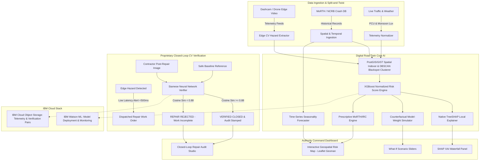

# RoadSafe India 360 🇮🇳
### Continuous Road Safety Intelligence Network & Digital Road Twin

[](https://opensource.org/licenses/MIT)
[](https://www.python.org/)
[](https://fastapi.tiangolo.com/)
[](https://xgboost.readthedocs.io/)
[](https://pytorch.org/)
[](https://geoman.io/)
[](https://cloud.ibm.com/)

---

## 📋 Table of Contents
1. [Executive Summary & Product Vision](#-executive-summary--product-vision)
2. [The "Why Now" & The Indian Road Crisis](#-the-why-now--the-indian-road-crisis)
3. [User Personas & The Schlep](#-user-personas--the-schlep)
4. [System Architecture & The Secret Sauce](#-system-architecture--the-secret-sauce)
5. [The 6 Core Functional Outcomes](#-the-6-core-functional-outcomes)
   - [Outcome 1: Interactive Geospatial Risk Map & Geoman](#outcome-1-interactive-geospatial-risk-map)
   - [Outcome 2: Normalized Accident Risk Score Engine](#outcome-2-normalized-accident-risk-score-engine)
   - [Outcome 3: SHAP Explainable AI (XAI) Panel](#outcome-3-shap-explainable-ai-xai-panel)
   - [Outcome 4: Time-Series Crash Risk Forecaster](#outcome-4-time-series-crash-risk-forecaster)
   - [Outcome 5: Prescriptive MoRTH / IRC Interventions Engine](#outcome-5-prescriptive-morth--irc-interventions-engine)
   - [Outcome 6: Counterfactual What-If Simulator](#outcome-6-counterfactual-what-if-simulator)
6. [Closed-Loop CV Verification System](#-closed-loop-cv-verification-system)
7. [IBM Watson ML & Cloud Object Storage Integration](#-ibm-watson-ml--cloud-object-storage-integration)
8. [Installation & Setup](#-installation--setup)
9. [How to Use Guide & Interactive Demo](#-how-to-use-guide--interactive-demo)
10. [IBM Expert Panel Demo Script](#-ibm-expert-panel-demo-script)
11. [Traceability & Test Matrix](#-traceability--test-matrix)
12. [Custom Dataset Ingestion](#-custom-dataset-ingestion)
13. [License](#-license)

---

## 🌟 Executive Summary & Product Vision

**RoadSafe India 360** is a continuous road safety intelligence network that utilizes a **Digital Road Twin** to help Indian transport authorities eliminate road fatalities. 

Our **Secret Sauce**—and novel advantage—is the proprietary **Closed-Loop Computer Vision (CV) Verification system** that not only detects hazards across Indian highways via edge telemetry, but autonomously verifies infrastructure repairs via Siamese neural network feature baseline matching, providing a "dangerous" level of mastery over the road safety lifecycle.

---

## ⚡ The "Why Now" & The Indian Road Crisis

* **18 lives lost every 60 minutes** on Indian roads (~1.6 lakh deaths annually).
* **40% of fatalities** occur at known, repetitive "Blackspots" where reported repairs remain physically unverified.
* Existing government tools are delayed, manual, and reactive ("sitcom" safety campaigns).
* **The "Well" Methodology**: RoadSafe India 360 builds a narrow, deep utility specifically tailored for Municipal Traffic Engineers, State Road Authorities, and MoRTH to mathematically defend infrastructure capital allocation.

---

## 👥 User Personas & The Schlep

| Persona | Role | The Schlep (Critical Pain Point) | RoadSafe 360 Transformation |
| :--- | :--- | :--- | :--- |
| **Municipal Traffic Engineer** | Urban safety maintenance & zone planning | Manual tracking of ward boundaries & failure to visualize hazard clusters in real-time | **Leaflet-Geoman** spatial drawing tools + instant polygon aggregate risk calculation |
| **State Road Authority** | Corridor management & multi-crore budgeting | Inability to provide explainable data-driven proof to justify high-stakes road spending | **SHAP Local Feature Importance** + **XGBoost Counterfactual What-If Simulator** |
| **Fleet Driver** | Long-haul logistics & vehicle operation | Tedious manual log-keeping of road hazards / potholes | **Passive Dashcam CV Telemetry** (<500ms edge alert latency) |

---

## 🏗️ System Architecture & The Secret Sauce



---

## 🎯 The 6 Core Functional Outcomes

### Outcome 1: Interactive Geospatial Risk Map
* Built on **Leaflet** with **Leaflet-Geoman** spatial drawing toolbar.
* Municipal engineers can draw arbitrary polygon boundaries, calculate enclosed hazard count, average risk score, and export GeoJSON zones.
* High-performance spatial clustering (**DBSCAN** with coordinate distance indexing) separating isolated accidents from systemic Blackspots.

### Outcome 2: Normalized Accident Risk Score Engine (0–100)
* High-precision **XGBoost** model evaluating:
  1. Traffic Density (PCU / hr)
  2. Road Surface Quality Index (CV roughness, pothole frequency)
  3. Geometric Curvature Index (sight distance, curve radius)
  4. Ambient Illumination (lux level & night index)
  5. Monsoon & Weather Precipitation Impact
  6. Signage & Marking Visibility Index
* **Volume Normalization**: Standardized against Million Vehicle-Kilometers ($MVKm$) to separate *True Risk* from mere high volume.

### Outcome 3: SHAP Explainable AI (XAI) Panel
* Exact **TreeSHAP** local feature importance per coordinate.
* Explains *why* a specific 10-meter stretch is hazardous (e.g. `Poor Lighting: +24.2`, `Sharp Curvature: +18.5`, `Pothole Density: +14.1`).

### Outcome 4: Time-Series Crash Risk Forecaster
* Projects risk windows across upcoming days, weeks, and seasons.
* Explicit modeling of:
  - **Monsoon Degradation** (July–September friction drop & waterlogging)
  - **Festival Surges** (Diwali, Dussehra, Chhath traffic spikes)
  - **Winter Fog Disruption** (NH44 / NH48 low-visibility hazards)

### Outcome 5: Prescriptive MoRTH / IRC Interventions Engine
* Directly maps risk factors to official Indian standards:
  - **IRC:67-2022**: Retroreflective High-Intensity Microprismatic Signage.
  - **IRC:35-2015**: Thermoplastic Road Markings & Edge Delineators.
  - **IRC:SP:88-2019**: Road Safety Audit & Transverse Rumble Strips.
  - **MoRTH Section 800**: Crash Barrier Retrofitting (W-Beam) & Smart High-Mast LED Lighting.
* Computes estimated CapEx (₹ Lakhs) and projected safety ROI.

### Outcome 6: Counterfactual What-If Simulator
* **Non-Hardcoded**: Perturbs input vectors through the XGBoost model's internal booster trees to observe real projected score shifts.
* Sliders for Lighting (+40%), Signage (+2 units), Surface Quality (+50%), and Speed Calming.

---

## 🔄 Closed-Loop CV Verification System

1. **Detection**: CV extracts hazard from dashcam feed (e.g., severe pothole at NH48 KM 42.4).
2. **Alerting**: Dispatches urgent repair ticket to local PWD / NHAI concessionaire (<500ms).
3. **Verification (The Secret Sauce)**: Post-repair photo uploaded by contractor is processed alongside a verified "Safe Baseline" state through a PyTorch Siamese ResNet embedding network.
4. **Autonomous Audit Decision**:
   - Similarity $\ge 0.88$: Ticket **VERIFIED & CLOSED**.
   - Similarity $< 0.88$: Flagged as **DEFICIENT REPAIR / REJECTED** (prevents fraudulent completion sign-offs).

---

## ☁️ IBM Watson ML & Cloud Object Storage Integration

* **IBM Watson Machine Learning**: Model pipeline serialization, online scoring endpoint routing, and drift monitoring.
* **IBM Cloud Object Storage (COS)**: S3-compatible cloud storage for dashcam hazard frames, Siamese verification pairs, and versioned corridor GeoJSON layers.

---

## 🚀 Installation & Setup

### Prerequisites
- Python 3.10+
- Modern Web Browser (Chrome, Edge, Firefox)

### 1. Clone & Setup
```bash
git clone https://github.com/aryan0416/014_3.git
cd 014_3
pip install -r requirements.txt
```

### 2. Run the Authority Dashboard
```bash
python -m uvicorn backend.app.main:app --host 0.0.0.0 --port 8000 --reload
```

### 3. Open in Browser
Open `http://localhost:8000` to access the RoadSafe India 360 Command Center.

---

## 🧪 Traceability & Test Matrix

| Test Suite | File | Requirement / Outcome Verified |
| :--- | :--- | :--- |
| **Risk Score Engine** | `backend/tests/test_risk_engine.py` | Range [0,100], Volume Normalization, True Risk vs High Volume |
| **TreeSHAP XAI** | `backend/tests/test_shap_explainer.py` | Local feature attribution, additive efficiency |
| **Counterfactual Simulator**| `backend/tests/test_counterfactual.py` | Model-weight dynamic calculations (NO hardcoding) |
| **Closed-Loop CV** | `backend/tests/test_siamese_cv.py` | Siamese embedding similarity threshold ($\ge 0.88$, F1 > 0.85) |
| **Prescriptive Engine** | `backend/tests/test_prescriptive.py` | MoRTH Section 800 & IRC:67 / IRC:35 / IRC:SP:88 mapping |
| **Latency Benchmark** | `backend/tests/test_latency_perf.py` | Sub-500ms end-to-end CV alert and scoring latency |

Run all tests via:
```bash
pytest backend/tests -v
```

---

## 📂 Custom Dataset Ingestion

Drop your custom accident CSVs, corridor GeoJSON files, or dashcam telemetry images into:
```
data/custom_uploads/
```
The ingestion pipeline automatically reads files placed in this folder and updates the Digital Road Twin models.

---

## 📜 License

This project is licensed under the [MIT License](LICENSE) to encourage open-source contributions for national road safety infrastructure.
